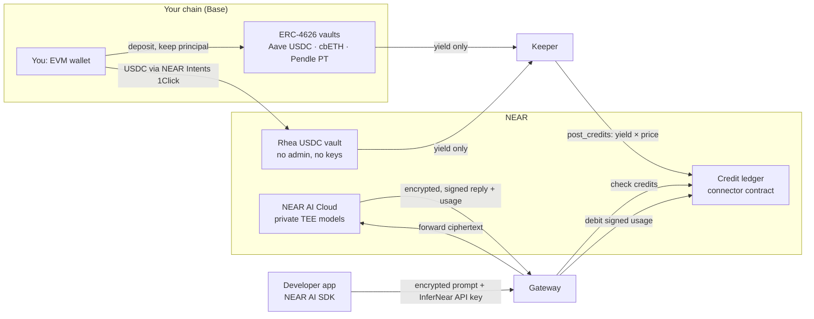

# InferNear

**Private AI inference for people on every chain, paid for by the yield on their own deposits.**

InferNear is an OpenAI-format API endpoint on top of NEAR AI's private TEE models. You deposit into a vault on your own chain and keep the principal; the yield goes to InferNear and comes back to you as API credits on NEAR. You call the endpoint with NEAR AI's official SDK, which encrypts the prompt on your machine to an attested model, so the relay forwards ciphertext. You never need a NEAR account or NEAR tokens: only InferNear does.

Built at the NEAR HACKATHON (1–14 Nov 2026).

> **Status: built and tested locally; not yet deployed.** Every command in this README runs from a clean clone, offline after install, against mocks and fixtures. **No live inference, mainnet deployment, deposit or bridge has been run yet.** The dashboard runs on clearly labelled mock data until the contracts are deployed, and its "Try the API" panel is a labelled simulation. This section will list deployed addresses and the live endpoint once they exist.

## How it works



1. **Deposit on your chain.** Each vault is an ERC-4626 vault with no owner, admin, upgrade or pause. You can redeem your principal at any time; only the surplus above principal is paid to InferNear.
2. **Yield becomes credits.** The keeper reads each holder's attributed yield at a finalized block, prices it in USD, and posts it to the NEAR connector. Credits can only come from posted yield: `spent ≤ credited` per user, enforced on chain.
3. **Call the API.** Sign in with your wallet (EIP-4361) to create an API key, then point NEAR AI's SDK at InferNear's endpoint. The SDK encrypts each request to a model's TEE and verifies its attestation and response signature. The gateway charges the model's reported `usage` against your credits.

## Four vaults

| Vault | Chain | You deposit | Yield shape | Credit price source |
|---|---|---|---|---|
| Aave USDC | Base | USDC | growing balance | 1 USDC = $1 |
| cbETH | Base | cbETH | uncapped appreciation (liquid staking) | Chainlink cbETH/USD |
| Pendle PT-deJAAA | Base | PT-deJAAA (USD PT, expires 26 Nov 2026) | capped appreciation | Pendle 15-minute TWAP |
| Rhea USDC | NEAR | Base USDC, bridged by NEAR Intents | lending interest on Rhea Lend | 1 USDC = $1 |

A fourth shape, staking with claimable rewards, is built and tested (`StakingRewardsVault`) but not in the deployment set.

**Depositors bear strategy losses pro-rata.** If Aave, cbETH's exchange rate, the PT's backing (a Centrifuge AAA CLO note) or Rhea lose value, the loss falls on depositors; InferNear holds no reserve. Credits already granted are not clawed back. The dashboard shows this note next to each vault.

## What uses NEAR

- **NEAR AI Cloud private inference:** only attested `vllm` TEE models with end-to-end encryption are listed and accepted.
- **NEAR Intents (1Click):** moves Base USDC into the Rhea vault and back to your Base address, and bridges InferNear's treasury yield to NEAR.
- **NEAR contracts:** the credit ledger (`contracts/near/src`) and a keyless Rhea USDC vault (`contracts/near/rhea-vault`) that you control with your EVM wallet's signature.
- **Rhea Lend:** the Rhea vault supplies USDC to `contract.main.burrow.near`.

## Verify it yourself

Prerequisites: Node 24.22.1+, Foundry (Forge 1.5.1), rustup Rust 1.97.1 with the `wasm32-unknown-unknown` target, a C/C++ toolchain and CMake. Each step needs network access once to install dependencies.

```sh
# API relay: gateway + keeper (41 tests, then an end-to-end demo on fixtures)
cd relay && npm ci --ignore-scripts && npm test && npm run demo && cd ..

# Dashboard (36 tests, production build); `npm run dev` serves it on mock data
cd web && npm ci --ignore-scripts && npm test && npm run build && cd ..

# Base vaults (77 offline tests, including invariant fuzzing)
cd contracts/evm && npm ci --ignore-scripts && forge build && forge test --offline && cd ../..

# NEAR credit ledger and Rhea vault (45 tests)
cd contracts/near && cargo fetch --locked && cargo test --locked --workspace && cd ../..
```

`npm run demo` prints a fixture flow: a holder receives 1,000 micro-USD of credits from a finalized vault snapshot, spends 13 through the HTTP API, and has 987 left.

Each component's README has the full verification set: Base fork tests against real cbETH and Pendle state, the NEAR sandbox gas test, WASM builds, formatting and lint.

| Component | Path | README |
|---|---|---|
| Base vaults (Solidity, Foundry) | `contracts/evm/` | [contracts/evm/README.md](contracts/evm/README.md) |
| Credit ledger and Rhea vault (Rust, near-sdk) | `contracts/near/` | [contracts/near/README.md](contracts/near/README.md), [rhea-vault/README.md](contracts/near/rhea-vault/README.md) |
| Gateway and keeper (TypeScript, Node) | `relay/` | [relay/README.md](relay/README.md) |
| Dashboard (Vite, React) | `web/` | [web/README.md](web/README.md) |
| Interfaces between components | `docs/` | [docs/interfaces.md](docs/interfaces.md) |
| Deployment (Docker, Cloudflare Tunnel) | `deploy/` | [deploy/README.md](deploy/README.md) |

## Fund-safety rules

These are enforced in the contracts and tested in the contract and relay suites:

1. Principal is never spendable as credits.
2. Credits spent ≤ yield realized, per user, always.
3. Principal + unspent realized yield + unrealized yield = position value, in integer base units within documented rounding.
4. You can always withdraw your principal, minus documented protocol exit costs and pro-rata strategy losses.

No contract has an owner, admin, pause or upgrade path. The Rhea vault's full-access keys are deleted at deployment.

## Not done yet, and known limits

- **Live inference is unverified.** The SDK probe (`relay`, `npm run spike`) is written but has not run against NEAR AI. Until it passes, end-to-end encryption, streaming usage and signature checks are designed and unit-tested only.
- **Nothing is deployed.** No vault, connector or relay is live, so the dashboard uses mock data.
- **The relay is trusted for prices and attribution.** It cannot spend principal, but it decides how yield is priced and who earned it; both are publicly recomputable from chain data.
- **Encryption hides content, not metadata.** A relay can still observe request size, timing and token counts.

## Third-party libraries and services

All installed through package managers at pinned versions; no templates or pre-existing code were copied in.

| Component | Libraries |
|---|---|
| Base vaults | OpenZeppelin Contracts 5.4, Aave v3 origin 3.6, Aave address book, forge-std (tests) |
| NEAR contracts | near-sdk and near-contract-standards 5.30; near-workspaces, proptest and tokio (tests) |
| Relay and NEAR scripts | viem, near-api-js; TypeScript (type checks) |
| Dashboard | React 19, viem, @scure/base, Vite, Fontsource fonts (Hanken Grotesk, Martian Mono, Instrument Serif) |
| Live SDK probe (optional) | NEAR AI's official [inference SDK](https://github.com/nearai/inference-sdk), installed outside the repo |

External services used at runtime: NEAR AI Cloud, NEAR Intents 1Click, Rhea Lend, Aave v3, Pendle, Chainlink price feeds, and Base and NEAR RPC endpoints.

## Prior art

Paying for AI with yield is not new. NEAR AI's own Staking for Inference (announced July 2026) converts NEAR staking yield into inference credits for NEAR stakers, and BRRRAIN pools staked NEAR to give holders AI credits through a gateway that sees plaintext prompts. Venice, Morpheus and 0G use token-based credit models. InferNear differs in who it serves and how: users on other chains keep the asset they already hold, earn market yield in several shapes with no NEAR price exposure, get a per-user on-chain credit ledger, and send prompts the relay cannot read.
