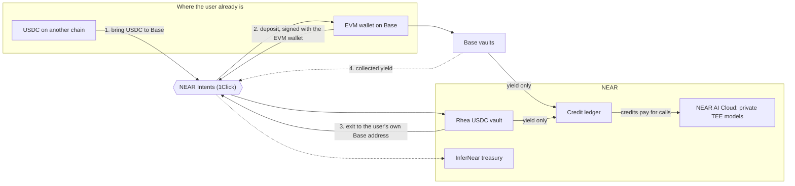
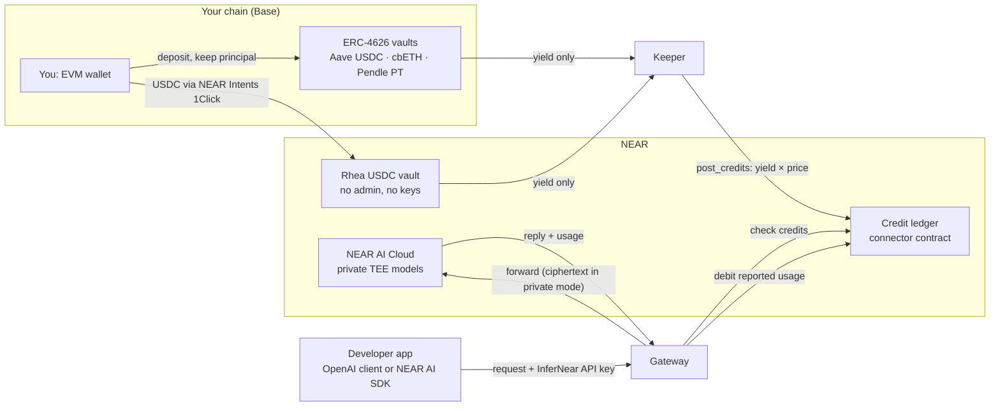

<picture>
  <source media="(prefers-color-scheme: dark)" srcset="docs/assets/logo-dark.svg">
  
</picture>

# InferNear

**Private AI inference for people on every chain, paid for by the yield on their own deposits.**

InferNear is an OpenAI-format API endpoint on top of NEAR AI's private TEE models. You deposit into a vault on your own chain and keep the principal; the yield goes to InferNear and comes back to you as API credits on NEAR. You call the endpoint in one of two ways: with any OpenAI client, by changing the base URL and key (standard mode, where the relay can read the prompt in transit), or with NEAR AI's official SDK, which encrypts the prompt on your machine to an attested model so the relay forwards ciphertext it cannot read (private mode). You never need a NEAR account or NEAR tokens: only InferNear does.

Built at the NEAR HACKATHON (1–14 Nov 2026).

> **Status (13 Nov 2026): deployed on mainnet, with small caps.** The API is live at `https://api.infernear.dev/v1`, the console at `https://app.infernear.dev` and the landing page at `https://infernear.dev`. Three Base vaults, the credit top-up contract, the NEAR credit ledger and the Rhea vault on NEAR are live. Free trial calls work on the live endpoint today (a real model reply, checked on 13 Nov). No user has deposited or bought credits yet, so no credits exist on the ledger and no credit-paid call has been made: see [known limits](#not-done-yet-and-known-limits). Every command under "Verify it yourself" runs from a clean clone, offline after install, against mocks and fixtures.

## The problem

NEAR AI Cloud runs open models inside attested TEEs, so a prompt can stay private from the operator. But it is paid for from a NEAR AI account, and most people who want private AI keep their assets and wallets on other chains. They also do not want API bills to eat their capital. InferNear gives them one OpenAI-format endpoint, sign-in with the wallet they already have, and a way to pay with the yield on a deposit they keep.

## What NEAR does in InferNear

| NEAR technology | What it does here | Where in this repo | Check it |
|---|---|---|---|
| **NEAR AI Cloud** (private inference) | Every model InferNear serves is one of NEAR AI Cloud's attested `vllm` TEE chat models. The relay lists them with their prices, forwards each call on InferNear's own NEAR AI account, and bills from the usage the model reports. | `relay/src/gateway/upstream.ts`, `ledger.ts`, `meter.ts` | `curl -s https://api.infernear.dev/v1/models` |
| **NEAR AI TEE attestation and signed replies** | In private mode NEAR AI's inference SDK checks the model's hardware attestation, encrypts the prompt to that TEE and verifies the model's signature over the reply. The relay only carries ciphertext. | `relay/scripts/spike.ts`, `relay/scripts/provenance.json`, `web/src/quickstart.ts` | [Live SDK probe](relay/README.md#live-sdk-probe--passed-on-2026-11-12) |
| **NEAR Intents (1Click API)** | Carries USDC between chains: from Base into the Rhea vault on NEAR, the principal back to the user's own Base address, quotes for USDC arriving from other chains, and (switched off in this deployment) the treasury's yield to NEAR. | `web/src/data/rhea.ts`, `relay/src/gateway/signed.ts`, `relay/src/adapters/evm.ts` | [the dry-run quote](#near-intents-the-rail-between-a-users-chain-and-near) |
| **NEAR smart contracts** (near-sdk) | The **credit ledger** `connector.infernear-ai.near` records, per user, the credits posted and spent, and keeps a receipt for every paid call; it has no keys. The **Rhea USDC vault** `rhea.infernear-ai.near` holds principal for EVM and NEAR users and pays out only yield. | `contracts/near/src/lib.rs`, `contracts/near/rhea-vault/src/lib.rs` | explorer links in [Live deployment](#live-deployment) |
| **Rhea Lend** (lending on NEAR) | The Rhea vault supplies its USDC there; the interest is the yield that becomes credits. | `contracts/near/rhea-vault/src/lib.rs` | [its first cycle on mainnet](https://nearblocks.io/txns/5K8tsb9HZNFQJDbbSj2arXd2xHjyrtxzGaK4QPTsC7oW) |
| **NEAR accounts and wallets** | A NEAR user signs in with Meteor Wallet (NEP-413) to get API keys under their own account, can deposit into the Rhea vault from it, and can link an EVM wallet to the same InferNear account. | `relay/src/gateway/auth.ts`, `relay/src/gateway/accounts.ts`, `web/src/data/near-session.ts` | sign in at the console |

Settlement is on NEAR throughout: credits are posted to the ledger by a keeper, and each paid call is debited there under its inference ID.

## Try it

**No wallet, a few minutes.**

1. `curl -s https://api.infernear.dev/v1/models` → a list of 7 NEAR AI TEE models, each with `inputCostPerToken` and `outputCostPerToken`.
2. Open `https://app.infernear.dev` → the Vaults tab shows the four vaults, read from Base and NEAR: the amount deposited for the three Base vaults, and the current supply rate for the Aave and Rhea vaults (the cbETH and Pendle vaults have no single on-chain rate to show).
3. Open the explorer links under [Live deployment](#live-deployment) → the contracts.
4. A real model reply, with no wallet of your own: `cd relay && npm ci --ignore-scripts && npm run live-check` → a throwaway key signs in to the live relay, receives an API key and makes one free call. It prints seven `ok` lines (7 models, the key, `5 of 5` free calls, the model's reply `"ok"`, `billing: free` with an inference ID, `4` left) and ends with `PASS`. It sends no transaction and uses one of the day's 300 shared free calls.

**With a wallet and no funds.** Each wallet gets 5 free trial calls, paid by InferNear (300 a day across all wallets).

5. In the console, connect an EVM wallet (on Base) or Meteor Wallet (NEAR). Optionally open the account button and pick a handle.
6. **API keys** → create a key (your wallet signs one message; no transaction is sent) → the key is shown once.
7. **Try the API** → choose a model → Run → the model's reply appears with a "Free trial" result, and the count goes from 5 to 4.
8. Or use the key from a terminal:

   ```sh
   curl -s -D - https://api.infernear.dev/v1/chat/completions \
     -H "Authorization: Bearer $INFERNEAR_API_KEY" -H 'Content-Type: application/json' \
     -d '{"model":"Qwen/Qwen3-VL-30B-A3B-Instruct","messages":[{"role":"user","content":"Reply with the single word: ok"}],"max_tokens":64}'
   ```

   → `200`, an OpenAI-format completion, and the header `x-infernear-billing: free`. With no free calls left and no credits it answers `402 insufficient_credit`.

**With funds (optional, small amounts). Built, tested on fixtures and on a fork of live Base, but not yet run with real money on mainnet.**

9. **Account** → Add credits → buy 1 USDC of credits on Base (a purchase, not redeemable) → about 20 minutes later the Account tab shows $1.00 of credits, posted on NEAR.
10. Or deposit USDC into the Aave USDC vault → its yield is posted as credits once it is worth $0.001; the principal stays redeemable.
11. A call paid with credits shows its debit on NEAR in the result panel, under its inference ID.

**From a clean clone, with no network after install:** [Verify it yourself](#verify-it-yourself), five command blocks and the test counts each one prints.

## Live deployment

| Piece | Where |
|---|---|
| API endpoint | `https://api.infernear.dev/v1` (OpenAI Chat Completions format; `GET /v1/models` lists the served TEE models) |
| Landing page | `https://infernear.dev` |
| Console | `https://app.infernear.dev` |
| Credit ledger (NEAR) | [`connector.infernear-ai.near`](https://nearblocks.io/address/connector.infernear-ai.near) |
| Rhea USDC vault (NEAR) | [`rhea.infernear-ai.near`](https://nearblocks.io/address/rhea.infernear-ai.near) |
| Aave USDC vault (Base) | [`0x19110449a361855d30090BC26112E9a5c3793198`](https://basescan.org/address/0x19110449a361855d30090BC26112E9a5c3793198) |
| cbETH vault (Base) | [`0x20B3852c32FFCBfD6a713045e7eA411683446f40`](https://basescan.org/address/0x20B3852c32FFCBfD6a713045e7eA411683446f40) |
| Pendle PT-deJAAA vault (Base) | [`0x5801707F6AF54f33Ab3E1910c09D79B81D4Be92c`](https://basescan.org/address/0x5801707F6AF54f33Ab3E1910c09D79B81D4Be92c) |
| Credit top-up (Base) | [`0xa62E3f3328e33DeB233C655df4f379c1bE7b03c6`](https://basescan.org/address/0xa62E3f3328e33DeB233C655df4f379c1bE7b03c6) |

Each vault has a deposit cap of about $10,000 (Rhea 10,000 USDC, Aave 10,000 USDC, cbETH 5 ETH of principal, Pendle 10,000 USD of PT principal) and a small cushion donated at deployment that absorbs rounding.

### The deployed code is this repository's code

**NEAR.** Build both contracts and hash them:

```sh
cd contracts/near && cargo build --locked --target wasm32-unknown-unknown --release --workspace
shasum -a 256 target/wasm32-unknown-unknown/release/infernear_connector.wasm target/wasm32-unknown-unknown/release/infernear_rhea_vault.wasm
```

| Contract | Bytes | sha256 of the build | `code_hash` on chain (the same 32 bytes in base58) |
|---|---|---|---|
| `connector.infernear-ai.near` | 352,257 | `00405ebcf2c94c06ce4672a9bc4bc8eac8adae652fbd424c4d5e0649baf6fb65` | `1yvttLvjVnHFuuDgWrQNZYNbvsCtSctYKDwv5dRajye` |
| `rhea.infernear-ai.near` | 427,731 | `87f913f1ecd7dd80358d48dd97130dbc6138bd1376adc0e52042ae32e289d92c` | `A9nKrBReW24CktqUiFPnG4YHBmHgAzaQbh8ezpyxQiKD` |

The on-chain value is the `code_hash` field of a `view_account` query on any NEAR RPC. We get these hashes with Rust 1.97.1 from two different checkout paths on macOS (checked 13 Nov 2026); another toolchain can produce different bytes.

**Base.** `cd contracts/evm && forge build`, then compare each contract's deployed runtime bytecode (`cast code <address>`) with `deployedBytecode` in `out/<Contract>.sol/<Contract>.json`: they are equal apart from the constructor's immutable values.

## NEAR Intents: the rail between a user's chain and NEAR

NEAR AI Cloud's private models are paid for on NEAR, but most people's assets and wallets are somewhere else. InferNear is designed around **NEAR Intents (the 1Click API)** as the rail between the two, so a user on another chain can fund private inference without holding a NEAR account, a NEAR key or NEAR tokens. **What is live today is narrower than the design:** the console fetches real quotes from NEAR Intents, and the routes that carry funds (rows 2 to 4 below) are built and tested on fixtures but have not carried funds on mainnet yet. The three Base vaults and the credit top-up do not need Intents: their yield and purchases are read on Base and posted to the NEAR ledger by the keeper.



| # | What NEAR Intents carries | How | Where in this repo | Status on 12 Nov 2026 |
|---|---|---|---|---|
| 1 | USDC from another chain to the user's own Base address, ready to deposit | 1Click quote, then one transfer on the origin chain | `web/src/screens/Bridge.tsx` | The console shows real 1Click dry-run quotes for USDC from Ethereum, Arbitrum, Optimism or Polygon to Base; sending is switched off in this release |
| 2 | Base USDC into the Rhea USDC vault **on NEAR** | 1Click delivers native USDC to the vault with `ft_transfer_call`, carrying `{"user":"eip155:8453:<address>"}` so the vault records the principal under the user's EVM address | `web/src/data/rhea.ts`, `contracts/near/rhea-vault/src/lib.rs` (`ft_on_transfer`) | Built and tested on fixtures; the live route returns quotes (dry run below); no funded deposit yet |
| 3 | The user's principal back from NEAR to their own Base address | The user signs a withdrawal with their EVM wallet (ERC-191); the vault pays out through `intents.near` to that same address, and a second signed intent moves it to Base. The relay submits both, so the user pays no NEAR gas | `contracts/near/rhea-vault/src/lib.rs` (`request_withdraw`), `relay/src/gateway/signed.ts` (`/rhea/withdraw`, `/intents/execute`) | Built and tested on fixtures; not yet run with funds |
| 4 | InferNear's collected yield from Base to its treasury on NEAR | The keeper asks 1Click for a quote and sends the yield token to the deposit address once it is worth bridging | `relay/src/adapters/evm.ts` (`bridgeToken`) | Built and tested; switched off in this deployment (`ONECLICK_TOKENS=[]`) |

What that buys the user:

- **No NEAR account anywhere.** An EVM signature is the only thing a Base user ever produces: for deposits, for withdrawals from the NEAR vault, and for API keys.
- **Principal comes home.** Exits from the NEAR vault can only be paid to the EVM address that owns the position; the relay cannot redirect them.
- **One credit balance.** Yield from every vault, on Base or on NEAR, lands on the same NEAR ledger and is spent on NEAR AI Cloud.

Check the live route yourself. This asks NEAR Intents for a dry-run quote of 2 USDC from Base into the vault; it needs no key and sends nothing (it is a call to an outside service, so it can be unavailable; the address is InferNear's public yield recipient, standing in for a user's):

```sh
curl -s https://1click.chaindefuser.com/v0/quote -H 'content-type: application/json' -d '{
  "dry": true, "swapType": "EXACT_INPUT", "slippageTolerance": 100,
  "originAsset": "nep141:base-0x833589fcd6edb6e08f4c7c32d4f71b54bda02913.omft.near",
  "destinationAsset": "nep141:17208628f84f5d6ad33f0da3bbbeb27ffcb398eac501a31bd6ad2011e36133a1",
  "depositType": "ORIGIN_CHAIN", "recipientType": "DESTINATION_CHAIN", "refundType": "ORIGIN_CHAIN",
  "amount": "2000000", "recipient": "rhea.infernear-ai.near",
  "refundTo": "0xdf26ee9d5428ca51a7f9fa26c88bad8367423654",
  "customRecipientMsg": "{\"user\":\"eip155:8453:0xdf26ee9d5428ca51a7f9fa26c88bad8367423654\"}",
  "deadline": "2026-12-31T00:00:00.000Z"
}'
```

On 12 Nov 2026 it quoted about 1.9997 USDC delivered in about 35 seconds. The offline tests that pin this behaviour are in `web/src/data/live.test.ts` (route binding, funded quote, signed withdrawal and exit), `relay/test/signed.test.ts` (the relay refuses anything but the user's own signed request) and `contracts/near/rhea-vault/src/tests.rs`.

## How it works



1. **Deposit on your chain.** Each vault is an ERC-4626 vault with no owner, admin, upgrade or pause. You can redeem your principal whenever the underlying protocol has the liquidity to pay it (Aave and Rhea Lend can be fully lent out for a time; withdrawals from the Rhea vault queue until its next cycle); only the surplus above principal is paid to InferNear.
2. **Yield becomes credits.** The keeper reads each holder's attributed yield at a finalized block, prices it in USD, and posts it to the NEAR connector. Credits come only from what the keeper posts, which is realized yield and finalized USDC purchases through the top-up contract: `spent ≤ credited` per user, enforced on chain.
3. **Call the API.** Sign in with your wallet to create an API key: an EVM wallet (EIP-4361) or Meteor Wallet on NEAR (NEP-413). Then point an OpenAI client or NEAR AI's SDK at InferNear's endpoint. The gateway charges the model's reported `usage` against your credits. Each wallet gets 5 free trial calls, funded by InferNear, before credits are needed. You can pick a handle for your account and link a second wallet to it, EVM or NEAR, so one identity and one API key cover both.

### Two ways to call the API

| Mode | Client | What the relay sees | What is checked |
|---|---|---|---|
| **Standard** | Any OpenAI client: set the base URL to `https://api.infernear.dev/v1` and send `Authorization: Bearer inf_…` | The prompt and reply in transit; it stores neither | The model runs in NEAR AI's attested TEE; usage is taken as reported |
| **Private** | NEAR AI's inference SDK in application-proxy mode | Ciphertext only, plus request size, timing and token counts | The SDK encrypts each request to the model's TEE and verifies its attestation and the response signature |

The request itself picks the mode: the SDK's encryption headers select private mode, and an incomplete set is refused rather than downgraded to standard. Both modes serve the same attested models at the same prices ([gateway details](relay/README.md#gateway-behavior-and-limits)).

## Four vaults

| Vault | Chain | You deposit | Yield shape | Credit price source |
|---|---|---|---|---|
| Rhea USDC | NEAR | Base USDC, bridged by NEAR Intents | lending interest on Rhea Lend | 1 USDC = $1 |
| Aave USDC | Base | USDC | growing balance | 1 USDC = $1 |
| cbETH | Base | cbETH | uncapped appreciation (liquid staking) | Chainlink cbETH/USD |
| Pendle PT-deJAAA | Base | PT-deJAAA (USD PT, expires 26 Nov 2026) | capped appreciation | Pendle 15-minute TWAP |

A fourth shape, staking with claimable rewards, is built and tested (`StakingRewardsVault`) but not in the deployment set.

**Depositors bear strategy losses pro-rata.** If Aave, cbETH's exchange rate, the PT's backing (a Centrifuge AAA CLO note) or Rhea lose value, the loss falls on depositors; InferNear holds no reserve. Credits already granted are not clawed back. The dashboard shows this note next to each vault.

### Buying credits directly

`CreditTopUp` (`contracts/evm/src/CreditTopUp.sol`) sells credits for USDC at 1 USDC = $1 of credits. **It is a purchase, not a deposit: the USDC goes straight to InferNear and cannot be redeemed.** The contract holds no funds and has no owner, admin, pause or upgrade path. The keeper credits each buyer from the contract's finalized `paid` totals, and the console shows an "Add credits" box when the contract's address is configured. It was deployed on Base on 13 Nov 2026 ([transaction](https://basescan.org/tx/0xff918851dfb148b216a386834086b279d652c38976bb5c9e7b31074c2460e284)), with a 1 USDC minimum; credits appear after Base finality, about 20 minutes. No purchase has been made through it yet.

## Verify it yourself

Prerequisites: Node 24.22.1+, Foundry (Forge 1.5.1), rustup Rust 1.97.1 with the `wasm32-unknown-unknown` target, a C/C++ toolchain and CMake. Each step needs network access once to install dependencies.

```sh
# API relay: gateway + keeper (97 tests, then an end-to-end demo on fixtures)
cd relay && npm ci --ignore-scripts && npm test && npm run demo && cd ..

# Dashboard (104 tests, production build); `npm run dev` serves it on mock data unless the live `VITE_*` settings are filled in
cd web && npm ci --ignore-scripts && npm test && npm run build && cd ..

# Base vaults and the credit top-up contract (85 offline tests, including invariant fuzzing)
cd contracts/evm && npm ci --ignore-scripts && forge build && forge test --offline && cd ../..

# NEAR credit ledger and Rhea vault (58 tests)
cd contracts/near && cargo fetch --locked && cargo test --locked --workspace && cd ../..

# Landing page (static production build)
cd landing && npm ci --ignore-scripts && npm run build && cd ..
```

What each block prints when it passes:

| Block | Expected |
|---|---|
| Relay | `ℹ tests 97`, `ℹ pass 97`, `ℹ fail 0`, then the demo's last line `{"fixture":true,"status":200,"credited":"1000","spent":"13","available":"987"}` |
| Dashboard | `ℹ tests 104`, `ℹ pass 104`, `ℹ fail 0`, then `✓ built` |
| Base contracts | `85 tests passed, 0 failed, 3 skipped` (the three skipped tests need a Base RPC and are run separately, see `contracts/evm/README.md`) |
| NEAR contracts | `test result: ok. 14 passed` (credit ledger) and `test result: ok. 44 passed` (Rhea vault) |
| Landing page | `✓ built` |

The relay demo is a fixture flow: a holder receives 1,000 micro-USD of credits from a finalized vault snapshot, spends 13 through the HTTP API, and has 987 left.

Each component's README has the full verification set: Base fork tests against real cbETH and Pendle state, the NEAR sandbox gas test, WASM builds, formatting and lint.

| Component | Path | README |
|---|---|---|
| Base vaults (Solidity, Foundry) | `contracts/evm/` | [contracts/evm/README.md](contracts/evm/README.md) |
| Credit ledger and Rhea vault (Rust, near-sdk) | `contracts/near/` | [contracts/near/README.md](contracts/near/README.md), [rhea-vault/README.md](contracts/near/rhea-vault/README.md) |
| Gateway and keeper (TypeScript, Node) | `relay/` | [relay/README.md](relay/README.md) |
| Dashboard (Vite, React) | `web/` | [web/README.md](web/README.md) |
| Landing page (static, Vite) | `landing/` | [landing/README.md](landing/README.md) |
| Interfaces between components | `docs/` | [docs/interfaces.md](docs/interfaces.md) |
| Deployment (Docker, Cloudflare Tunnel) | `deploy/` | [deploy/README.md](deploy/README.md) |

## Fund-safety rules

These are enforced in the contracts and tested in the contract and relay suites:

1. Principal is never spendable as credits.
2. Credits spent ≤ credits posted (yield realized, plus any USDC purchased), per user, always.
3. Principal + unspent realized yield + unrealized yield = position value, in integer base units within documented rounding.
4. Your principal is always yours to withdraw, minus documented protocol exit costs and pro-rata strategy losses, and subject to the underlying protocol having the liquidity to pay it at that moment.

The three Base vaults and the credit ledger have no owner, admin, pause or upgrade path. **The Rhea vault on mainnet is the exception: it keeps its deployment key during the hackathon**, so its code can be fixed and the deployment wound down afterwards. Whoever holds that key could replace the vault's code, so treat the Rhea vault as operator-controlled until the key is deleted (the deploy script deletes it by default; `NEAR_RHEA_KEEP_KEY=true` keeps it).

## Not done yet, and known limits

- **Free trial counts are in relay memory.** Trials are capped at 300 calls a day across wallets; a restart resets both wallet counts and the daily total.
- **Accounts are a relay feature, not an on-chain one.** A handle, its permanent ID and its linked wallets are kept in a file on the relay. The ledger still holds one balance per wallet: a key can be charged to any linked wallet, but a single call is charged to one wallet, so two wallets that each hold too little are not added together. If that file is lost, handles and links have to be made again; no balance is affected.

- **Live inference was verified once, by probe.** On 2026-11-12 `npm run spike` in `relay` sent encrypted JS and Python requests, plain and streaming, through the relay to a NEAR AI TEE model; TEE signatures verified and every charge matched NEAR's bill after rounding up to whole micro-USD ([details](relay/README.md#live-sdk-probe--passed-on-2026-11-12)). It needs your own NEAR AI key to reproduce.
- **The model build check is off.** The SDK still verifies the model's TEE hardware attestation and signatures, but NEAR's check that the model runs NEAR's published proxy build currently rejects NEAR's own deploys, so we leave it out until NEAR fixes it. The gateway build check stays on.
- **The Rhea vault was redeployed with a fix on 13 Nov 2026.** Its first cycles on mainnet failed because the contract gave Rhea's asset view too little gas; a second defect (idle cash not supplied in a cycle that also pays yield) was fixed with it. The code was replaced on the same account with the stored state unchanged ([transaction](https://nearblocks.io/txns/DW2hx4izJCcMMgJ8C9h2cXaaNo2JcZAADMsnTJBu4D79)), and the next cycle supplied the vault's 1 USDC cushion to Rhea Lend ([transaction](https://nearblocks.io/txns/5K8tsb9HZNFQJDbbSj2arXd2xHjyrtxzGaK4QPTsC7oW)). It holds no user deposit yet.
- **Free trial calls work on the live relay; a credit-paid call has not been made.** `npm run live-check` in `relay/` reproduces it with a throwaway wallet: sign-in, a key, and a standard-mode call that returns a real reply billed as a free trial. On 13 Nov 2026 the same flow was also run with a handle and a second linked wallet. The real-wallet run through the console is still to come.
- **No deposit, credit or paid API call has happened on mainnet yet.** The contracts, relay and console are live, and wallet sign-in and API-key issue were checked against the live relay; the first funded round trip is still to come. The console's deposit, withdrawal and Meteor sign-in flows have so far run only in automated tests, not with a real wallet.
- **Standard mode and NEAR-wallet sign-in went live on 13 Nov 2026 and are only partly exercised.** Against the live relay, a throwaway EVM wallet signed in, received a key, and its plain OpenAI-format call was accepted up to the credit check (`402 insufficient_credit`, as expected with no credits). A paid standard call and a sign-in with a real NEAR wallet have not been done yet.
- **Standard mode is not private from the relay.** The relay can read the prompt and reply in transit; it stores neither. Use private mode when that matters.
- **In the console, "Try the API" sends a real standard-mode call; private mode there is code samples only.** A private call is made with NEAR AI's SDK from your own code, as in the probe above.
- **No credit purchase has been made yet.** The top-up contract is live and the console shows its box to EVM wallets, but the first real purchase, and the keeper crediting it, are still to come.
- **"From another chain" shows quotes only.** The console fetches real dry-run quotes from NEAR Intents; sending funds from that screen is switched off in this release.
- **Every API call is settled by its own NEAR transaction.** That costs the operator roughly 0.0015 NEAR per call in gas and permanent ledger storage, far more than the inference itself; the ledger as funded covers about 590 calls. A production version would batch debits.
- **PT-deJAAA expires on 26 Nov 2026.** After that the Pendle vault's PT stops appreciating.
- **The relay is trusted for prices and attribution.** It cannot spend principal, but it decides how yield is priced and who earned it; both are publicly recomputable from chain data.
- **Encryption hides content, not metadata.** A relay can still observe request size, timing and token counts.
- **The console's NEAR wallet dependency has open advisories.** `npm audit` in `web/` reports high-severity findings in packages pulled in by Meteor Wallet's SDK and the NEAR JS libraries (`decode-uri-component`, `elliptic`). They are transitive, are not suppressed, and are not patched here: the only fix npm offers replaces those libraries with breaking versions.

## Third-party libraries and services

All installed through package managers at pinned versions; no templates or pre-existing code were copied in.

| Component | Libraries |
|---|---|
| Base vaults | OpenZeppelin Contracts 5.4, Aave v3 origin 3.6, Aave address book, forge-std (tests) |
| NEAR contracts | near-sdk 5.30; near-contract-standards, near-workspaces, proptest and tokio (tests) |
| Relay and NEAR scripts | viem, near-api-js; TypeScript (type checks) |
| Dashboard | React 19, viem, @scure/base, @near-wallet-selector/core with its Meteor Wallet module, @near-js/transactions, buffer, Vite, Fontsource fonts (Hanken Grotesk, Martian Mono; the logo wordmark is outlined from Hanken Grotesk), @web3icons/react (MIT) for the chain, asset and protocol logos; Rhea's logo is Rhea's own file from rhea.finance |
| Landing page | Vite, three.js, @web3icons/core (MIT) for the logos, the same Fontsource fonts and Rhea logo |
| Deployment | Docker images `node:24.22.1-bookworm-slim` and `cloudflare/cloudflared:2026.10.7` |
| Live SDK probe (optional) | NEAR AI's official [inference SDK](https://github.com/nearai/inference-sdk), installed outside the repo |

External services used at runtime: NEAR AI Cloud, NEAR Intents 1Click, Rhea Lend, Aave v3, Pendle, Chainlink price feeds, and Base and NEAR RPC endpoints. The documented deployment adds a Cloudflare Tunnel in front of the relay and Vercel for the dashboard.

## Prior art

Paying for AI with yield is not new. NEAR AI's own Staking for Inference (announced July 2026) converts NEAR staking yield into inference credits for NEAR stakers, and BRRRAIN pools staked NEAR to give holders AI credits through a gateway that sees plaintext prompts. Venice, Morpheus and 0G use token-based credit models. InferNear differs in who it serves and how: users on other chains keep the asset they already hold, earn market yield in several shapes with no NEAR price exposure, get a per-user on-chain credit ledger, and can send prompts the relay cannot read.
