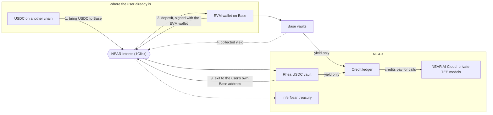
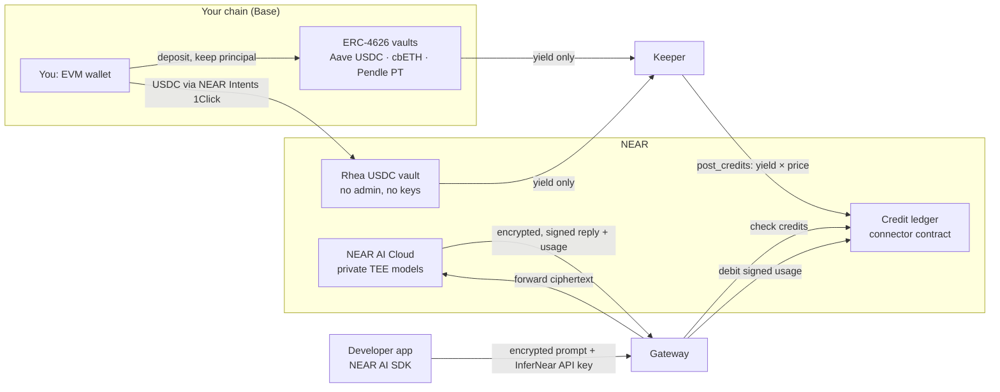

<picture>
  <source media="(prefers-color-scheme: dark)" srcset="docs/assets/logo-dark.svg">
  
</picture>

# InferNear

**Private AI inference for people on every chain, paid for by the yield on their own deposits.**

InferNear is an OpenAI-format API endpoint on top of NEAR AI's private TEE models. You deposit into a vault on your own chain and keep the principal; the yield goes to InferNear and comes back to you as API credits on NEAR. You call the endpoint with NEAR AI's official SDK, which encrypts the prompt on your machine to an attested model, so the relay forwards ciphertext. You never need a NEAR account or NEAR tokens: only InferNear does.

Built at the NEAR HACKATHON (1–14 Nov 2026).

> **Status (12 Nov 2026): deployed on mainnet, with small caps.** The API is live at `https://api.infernear.dev/v1` and the console at `https://app.infernear.dev`. Three Base vaults and the NEAR credit ledger are live; the **Rhea vault is deployed but paused** while a contract fix is redeployed (see known limits). No user deposit has been made yet, so no credits exist on the ledger. Every command under "Verify it yourself" still runs from a clean clone, offline after install, against mocks and fixtures.

## Live deployment

| Piece | Where |
|---|---|
| API endpoint | `https://api.infernear.dev/v1` (OpenAI Chat Completions format; `GET /v1/models` lists the served TEE models) |
| Console | `https://app.infernear.dev` |
| Credit ledger (NEAR) | [`connector.infernear-ai.near`](https://nearblocks.io/address/connector.infernear-ai.near) |
| Rhea USDC vault (NEAR) | [`rhea.infernear-ai.near`](https://nearblocks.io/address/rhea.infernear-ai.near), paused |
| Aave USDC vault (Base) | [`0x19110449a361855d30090BC26112E9a5c3793198`](https://basescan.org/address/0x19110449a361855d30090BC26112E9a5c3793198) |
| cbETH vault (Base) | [`0x20B3852c32FFCBfD6a713045e7eA411683446f40`](https://basescan.org/address/0x20B3852c32FFCBfD6a713045e7eA411683446f40) |
| Pendle PT-deJAAA vault (Base) | [`0x5801707F6AF54f33Ab3E1910c09D79B81D4Be92c`](https://basescan.org/address/0x5801707F6AF54f33Ab3E1910c09D79B81D4Be92c) |

Each vault has a deposit cap of about $10,000 (Rhea 10,000 USDC, Aave 10,000 USDC, cbETH 5 ETH of principal, Pendle 10,000 USD of PT principal) and a small cushion donated at deployment that absorbs rounding.

## NEAR Intents: every chain's yield, routed to NEAR AI

**This is the point of InferNear.** NEAR AI Cloud's private models are paid for on NEAR, but most people's assets and wallets are somewhere else. InferNear uses **NEAR Intents (the 1Click API)** as the rail between the two, so a user on another chain funds private inference without ever holding a NEAR account, a NEAR key or NEAR tokens.



| # | What NEAR Intents carries | How | Where in this repo | Status on 12 Nov 2026 |
|---|---|---|---|---|
| 1 | USDC from another chain to the user's own Base address, ready to deposit | 1Click quote, then one transfer on the origin chain | `web/src/screens/Bridge.tsx` | Console screen is built; its quote is still a labelled simulation |
| 2 | Base USDC into the Rhea USDC vault **on NEAR** | 1Click delivers native USDC to the vault with `ft_transfer_call`, carrying `{"user":"eip155:8453:<address>"}` so the vault records the principal under the user's EVM address | `web/src/data/rhea.ts`, `contracts/near/rhea-vault/src/lib.rs` (`ft_on_transfer`) | Built and tested on fixtures; the live route returns quotes (dry run below); no funded deposit yet, and the vault is paused |
| 3 | The user's principal back from NEAR to their own Base address | The user signs a withdrawal with their EVM wallet (ERC-191); the vault pays out through `intents.near` to that same address, and a second signed intent moves it to Base. The relay submits both, so the user pays no NEAR gas | `contracts/near/rhea-vault/src/lib.rs` (`request_withdraw`), `relay/src/gateway/signed.ts` (`/rhea/withdraw`, `/intents/execute`) | Built and tested on fixtures; not yet run with funds |
| 4 | InferNear's collected yield from Base to its treasury on NEAR | The keeper asks 1Click for a quote and sends the yield token to the deposit address once it is worth bridging | `relay/src/adapters/evm.ts` (`bridgeToken`) | Built and tested; switched off in this deployment (`ONECLICK_TOKENS=[]`) |

What that buys the user:

- **No NEAR account anywhere.** An EVM signature is the only thing a Base user ever produces: for deposits, for withdrawals from the NEAR vault, and for API keys.
- **Principal comes home.** Exits from the NEAR vault can only be paid to the EVM address that owns the position; the relay cannot redirect them.
- **One credit balance.** Yield from every vault, on Base or on NEAR, lands on the same NEAR ledger and is spent on NEAR AI Cloud.

Check the live route yourself. This asks NEAR Intents for a dry-run quote of 2 USDC from Base into the vault; it needs no key and sends nothing (it is a call to an outside service, so it can be unavailable; the address is InferNear's public yield recipient, standing in for a user's):

```sh
curl -s https://1click.chaindefuser.com/v0/quote -H 'content-type: application/json' -d '{
  "dry": true, "swapType": "EXACT_INPUT", "slippageTolerance": 100,
  "originAsset": "nep141:base-0x833589fcd6edb6e08f4c7c32d4f71b54bda02913.omft.near",
  "destinationAsset": "nep141:17208628f84f5d6ad33f0da3bbbeb27ffcb398eac501a31bd6ad2011e36133a1",
  "depositType": "ORIGIN_CHAIN", "recipientType": "DESTINATION_CHAIN", "refundType": "ORIGIN_CHAIN",
  "amount": "2000000", "recipient": "rhea.infernear-ai.near",
  "refundTo": "0xdf26ee9d5428ca51a7f9fa26c88bad8367423654",
  "customRecipientMsg": "{\"user\":\"eip155:8453:0xdf26ee9d5428ca51a7f9fa26c88bad8367423654\"}",
  "deadline": "2026-12-31T00:00:00.000Z"
}'
```

On 12 Nov 2026 it quoted about 1.9997 USDC delivered in about 35 seconds. The offline tests that pin this behaviour are in `web/src/data/live.test.ts` (route binding, funded quote, signed withdrawal and exit), `relay/test/signed.test.ts` (the relay refuses anything but the user's own signed request) and `contracts/near/rhea-vault/src/tests.rs`.

## How it works



1. **Deposit on your chain.** Each vault is an ERC-4626 vault with no owner, admin, upgrade or pause. You can redeem your principal at any time; only the surplus above principal is paid to InferNear.
2. **Yield becomes credits.** The keeper reads each holder's attributed yield at a finalized block, prices it in USD, and posts it to the NEAR connector. Credits can only come from posted yield: `spent ≤ credited` per user, enforced on chain.
3. **Call the API.** Sign in with your wallet (EIP-4361) to create an API key, then point NEAR AI's SDK at InferNear's endpoint. The SDK encrypts each request to a model's TEE and verifies its attestation and response signature. The gateway charges the model's reported `usage` against your credits.

## Four vaults

| Vault | Chain | You deposit | Yield shape | Credit price source |
|---|---|---|---|---|
| Rhea USDC | NEAR | Base USDC, bridged by NEAR Intents | lending interest on Rhea Lend | 1 USDC = $1 |
| Aave USDC | Base | USDC | growing balance | 1 USDC = $1 |
| cbETH | Base | cbETH | uncapped appreciation (liquid staking) | Chainlink cbETH/USD |
| Pendle PT-deJAAA | Base | PT-deJAAA (USD PT, expires 26 Nov 2026) | capped appreciation | Pendle 15-minute TWAP |

A fourth shape, staking with claimable rewards, is built and tested (`StakingRewardsVault`) but not in the deployment set.

**Depositors bear strategy losses pro-rata.** If Aave, cbETH's exchange rate, the PT's backing (a Centrifuge AAA CLO note) or Rhea lose value, the loss falls on depositors; InferNear holds no reserve. Credits already granted are not clawed back. The dashboard shows this note next to each vault.

## What uses NEAR

- **NEAR AI Cloud private inference:** only attested `vllm` TEE models with end-to-end encryption are listed and accepted.
- **NEAR Intents (1Click):** moves Base USDC into the Rhea vault and back to your Base address, and bridges InferNear's treasury yield to NEAR.
- **NEAR contracts:** the credit ledger (`contracts/near/src`) and a keyless Rhea USDC vault (`contracts/near/rhea-vault`) that you control with your EVM wallet's signature.
- **Rhea Lend:** the Rhea vault supplies USDC to `contract.main.burrow.near`.

## Verify it yourself

Prerequisites: Node 24.22.1+, Foundry (Forge 1.5.1), rustup Rust 1.97.1 with the `wasm32-unknown-unknown` target, a C/C++ toolchain and CMake. Each step needs network access once to install dependencies.

```sh
# API relay: gateway + keeper (63 tests, then an end-to-end demo on fixtures)
cd relay && npm ci --ignore-scripts && npm test && npm run demo && cd ..

# Dashboard (45 tests, production build); `npm run dev` serves it on mock data unless the live `VITE_*` settings are filled in
cd web && npm ci --ignore-scripts && npm test && npm run build && cd ..

# Base vaults and the credit top-up contract (85 offline tests, including invariant fuzzing)
cd contracts/evm && npm ci --ignore-scripts && forge build && forge test --offline && cd ../..

# NEAR credit ledger and Rhea vault (58 tests)
cd contracts/near && cargo fetch --locked && cargo test --locked --workspace && cd ../..
```

`npm run demo` prints a fixture flow: a holder receives 1,000 micro-USD of credits from a finalized vault snapshot, spends 13 through the HTTP API, and has 987 left.

Each component's README has the full verification set: Base fork tests against real cbETH and Pendle state, the NEAR sandbox gas test, WASM builds, formatting and lint.

| Component | Path | README |
|---|---|---|
| Base vaults (Solidity, Foundry) | `contracts/evm/` | [contracts/evm/README.md](contracts/evm/README.md) |
| Credit ledger and Rhea vault (Rust, near-sdk) | `contracts/near/` | [contracts/near/README.md](contracts/near/README.md), [rhea-vault/README.md](contracts/near/rhea-vault/README.md) |
| Gateway and keeper (TypeScript, Node) | `relay/` | [relay/README.md](relay/README.md) |
| Dashboard (Vite, React) | `web/` | [web/README.md](web/README.md) |
| Interfaces between components | `docs/` | [docs/interfaces.md](docs/interfaces.md) |
| Deployment (Docker, Cloudflare Tunnel) | `deploy/` | [deploy/README.md](deploy/README.md) |

## Fund-safety rules

These are enforced in the contracts and tested in the contract and relay suites:

1. Principal is never spendable as credits.
2. Credits spent ≤ yield realized, per user, always.
3. Principal + unspent realized yield + unrealized yield = position value, in integer base units within documented rounding.
4. You can always withdraw your principal, minus documented protocol exit costs and pro-rata strategy losses.

The three Base vaults and the credit ledger have no owner, admin, pause or upgrade path. **The Rhea vault on mainnet is the exception: it keeps its deployment key during the hackathon**, so its code can be fixed and the deployment wound down afterwards. Whoever holds that key could replace the vault's code, so treat the Rhea vault as operator-controlled until the key is deleted (the deploy script deletes it by default; `NEAR_RHEA_KEEP_KEY=true` keeps it).

## Not done yet, and known limits

- **Live inference was verified once, by probe.** On 2026-11-12 `npm run spike` in `relay` sent encrypted JS and Python requests, plain and streaming, through the relay to a NEAR AI TEE model; TEE signatures verified and every charge matched NEAR's bill after rounding up to whole micro-USD ([details](relay/README.md#live-sdk-probe--passed-on-2026-11-12)). It needs your own NEAR AI key to reproduce.
- **The model build check is off.** The SDK still verifies the model's TEE hardware attestation and signatures, but NEAR's check that the model runs NEAR's published proxy build currently rejects NEAR's own deploys, so we leave it out until NEAR fixes it. The gateway build check stays on.
- **The Rhea vault is paused.** On mainnet its first cycles failed because the contract gave Rhea's asset view too little gas; a second defect (idle cash not supplied in a cycle that also pays yield) is fixed in this repository. The fixed code has not been redeployed yet, so do not deposit into the Rhea vault.
- **No deposit, credit or paid API call has happened on mainnet yet.** The contracts, relay and console are live, and wallet sign-in and API-key issue were checked against the live relay; the first funded round trip is still to come.
- **The console's "Try the API" panel is a labelled simulation.** A real call is made with NEAR AI's SDK from your own code, as in the probe above.
- **Every API call is settled by its own NEAR transaction.** That costs the operator roughly 0.0015 NEAR per call in gas and permanent ledger storage, far more than the inference itself; the ledger as funded covers about 590 calls. A production version would batch debits.
- **PT-deJAAA expires on 26 Nov 2026.** After that the Pendle vault's PT stops appreciating.
- **The relay is trusted for prices and attribution.** It cannot spend principal, but it decides how yield is priced and who earned it; both are publicly recomputable from chain data.
- **Encryption hides content, not metadata.** A relay can still observe request size, timing and token counts.

## Third-party libraries and services

All installed through package managers at pinned versions; no templates or pre-existing code were copied in.

| Component | Libraries |
|---|---|
| Base vaults | OpenZeppelin Contracts 5.4, Aave v3 origin 3.6, Aave address book, forge-std (tests) |
| NEAR contracts | near-sdk 5.30; near-contract-standards, near-workspaces, proptest and tokio (tests) |
| Relay and NEAR scripts | viem, near-api-js; TypeScript (type checks) |
| Dashboard | React 19, viem, @scure/base, Vite, Fontsource fonts (Hanken Grotesk, Martian Mono; the logo wordmark is outlined from Hanken Grotesk), @web3icons/react (MIT) for the chain, asset and protocol logos |
| Deployment | Docker images `node:24.22.1-bookworm-slim` and `cloudflare/cloudflared:2026.10.7` |
| Live SDK probe (optional) | NEAR AI's official [inference SDK](https://github.com/nearai/inference-sdk), installed outside the repo |

External services used at runtime: NEAR AI Cloud, NEAR Intents 1Click, Rhea Lend, Aave v3, Pendle, Chainlink price feeds, and Base and NEAR RPC endpoints. The documented deployment adds a Cloudflare Tunnel in front of the relay and Vercel for the dashboard.

## Prior art

Paying for AI with yield is not new. NEAR AI's own Staking for Inference (announced July 2026) converts NEAR staking yield into inference credits for NEAR stakers, and BRRRAIN pools staked NEAR to give holders AI credits through a gateway that sees plaintext prompts. Venice, Morpheus and 0G use token-based credit models. InferNear differs in who it serves and how: users on other chains keep the asset they already hold, earn market yield in several shapes with no NEAR price exposure, get a per-user on-chain credit ledger, and send prompts the relay cannot read.
